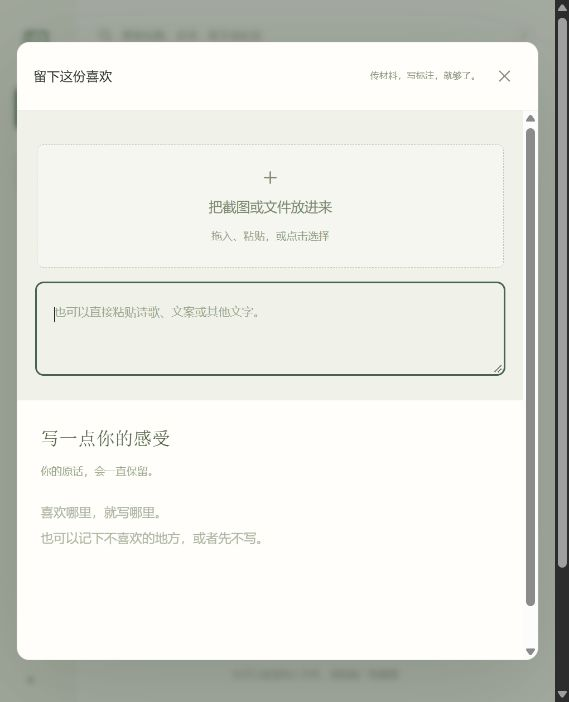
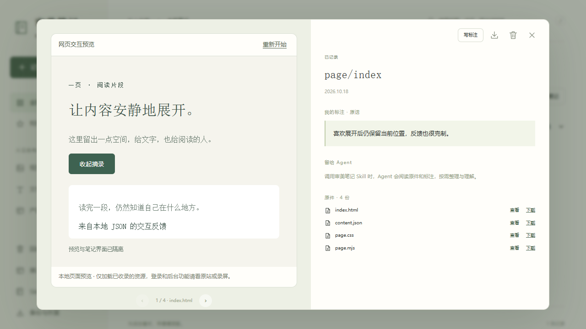

# 审美笔记 · Aesthetic Notes

**把日常的喜欢，变成 AI 创作时用得上的参考。**

我们每天都会遇到值得留下的东西：一张舒服的网页截图、一段有分寸的文案、一个让操作变简单的产品设计、一首说不清为什么喜欢的诗。

这些零散的喜欢，其实比“高级一点”“简洁一点”更接近一个人的审美。审美笔记把材料和你的感受留在一起，让 Agent 在做网页、界面、图示、PPT 或写作时，找到与当前任务有关的参考，理解你在意的具体部分。

日常只做两件事：**传材料，写标注。** 标注可以很短，也可以暂时留空。命名、分类、提炼和任务关联，在调用 Skill 时交给 Agent。

## 为什么做它

让 AI 做出东西已经很容易，让它做出“我喜欢的东西”仍然很费劲。

一次次输入风格词，很难传达真实的判断。“喜欢这张图”也不等于喜欢它的全部：你可能只喜欢留白，反感配色；觉得文案有趣，却不想沿用它的语气。

审美笔记希望留下这种具体、有上下文的判断。它的价值来自长期积累的**原始材料与个人点评**，以及创作时恰当地使用它们：

- **收集更轻。** 不必给灵感起标题、挑分类、补标签，想到什么就留下什么。
- **参考更具体。** Agent 可以回看原图、原文和你的原话，找到真正值得借鉴的部分。
- **积累可以复用。** 同一份材料能在不同任务里提供不同启发，已有文件夹也能直接成为资料库的一部分。
- **理解能够修正。** AI 的解释单独保存；材料或点评变了，就重新理解，原件和原话始终保留。

## 从记录到创作

### 1. 留下材料和感受

上传、拖入或粘贴截图，放入 PDF，直接粘贴网页链接、诗歌、文案或产品体验记录。HTML 与资源文件夹、操作录屏也可以作为原始材料留下。材料和标注自动保存；也可以点击“保存”，确认保存完成后返回收藏。

你可以写：“喜欢这里的文字密度，信息很多却不拥挤。”也可以写：“只喜欢这个操作过程，页面颜色太重了。”无需先把直觉翻译成专业设计术语。

### 2. 接入已有的文件夹

已经按自己的习惯整理过截图、PDF 和说明？直接接入文件夹。原目录、文件名和原件位置保留，工具建立只读索引，并检查新增与修改。

文件夹提供已有的组织线索。哪些文字在点评哪些图片、哪些内容与任务有关，由 Agent 结合原件判断。无需重新上传或改成统一的命名规则。

### 3. 让 Agent 带着任务阅读

工具侧栏的 **Skill** 入口提供完整安装包、安装说明和可复制的使用指令。关联自己的笔记库后，可以这样说：

> 使用审美笔记 Skill，整理新增材料。

或者直接带着创作任务调用：

> 参考我的审美笔记，帮我设计一个长文阅读页面。找找我对阅读节奏、文字密度和导航方式的点评。

Agent 按需查找记录，查看有关原件，区分你的判断与它自己的推测，再把相关参考用于当前创作。整理与理解发生在调用 Skill 时，收集材料无需等待模型。

## 三个部分，各做一件事

| 部分 | 负责什么 |
| --- | --- |
| 本地笔记工具 | 记录材料和标注、接入文件夹、浏览与备份 |
| Skill | 向 Agent 提供统一的读取与整理接口，并约定如何保留原话和使用参考 |
| Agent | 根据当前任务查看原件、理解点评、整理内容，并继续完成创作 |

这样的划分，让资料积累与具体模型分开。笔记工具无需配置 AI API；Skill 自带读取工具，网页关闭后仍可访问本机笔记。需要 Agent 能读取本机文件、运行脚本，并具备相应的图片或 PDF 阅读能力。

审美也不只属于图片。视觉材料可以谈布局与层次，文字可以谈节奏与分寸，产品记录可以谈流程与取舍。Agent 根据任务选择借鉴的维度，而收藏本身只表示你留下过这份材料。

## 当前版本

当前为 **0.3.0 早期实验版**，已实现：

- 收藏馆式界面：黑白灰、清晰层级与大图展台，让自己的材料成为视觉主角。逐张回看收藏，点击回到原笔记；搜索和批量选择时收起展台。
- 明确的“保存”按钮与完成提示，保留自动保存；保存失败时留在编辑窗口重试。
- 图片、PDF、TXT、Markdown 与直接粘贴文字；截图粘贴、拖入、自由标注和自动保存。
- 网页链接自动识别；HTML/HTM 与 CSS、JS、图片、字体等配套资源保留相对路径，支持完整网页文件夹导入与隔离交互预览。
- MP4、WebM、MOV、M4V 操作录屏收录与浏览器播放，支持拖动进度；实际播放能力取决于视频编码。
- 本地浏览、文字搜索、收藏、回收站、备份恢复与参考包导出。
- 原文件夹接入及变更检查，统一纳入 Skill 读取范围。
- Agent 整理结果与原始记录分开存储；内容变化后提示整理过期，拒绝旧版本写回。
- UI 内获取完整 Skill 安装包，查看本机 Codex 安装状态，复制笔记库关联指令。

一些边界也需要说清楚：

- 工具不会在后台持续调用 AI，也不会训练模型。当前搜索基于已有文字及有效的整理结果，尚无内置图片语义检索。
- 笔记存放在本机，工具服务只监听本机地址。交给 Agent 后如何处理材料，取决于所使用 Agent 的服务与权限，不能据此承诺 AI 推理全部离线。
- 云端 Agent 无法直接读取另一台电脑的本地目录，可以使用导出的参考包。
- 网页预览针对静态页面与前端交互，只加载收录的本地资源，不还原登录、远程接口或后台项目。依赖这些条件的体验需结合原站或录屏查看；链接本身也不会自动生成整站快照。Agent 会区分代码阅读、实际操作与录屏观察。
- 审美理解的效果取决于材料、点评和 Agent 的能力。当前已验证记录、读取与整理链路，长期创作效果仍需在真实使用中检验。

## 开始使用

需要 **Node.js 22 或以上版本**，应用无需安装额外 npm 依赖。

1. 下载仓库 ZIP 并解压，或克隆本仓库。
2. Windows 用户双击 **启动审美笔记.cmd**。其他环境可在项目目录运行 `npm start`，打开 `http://127.0.0.1:4317`。原生文件夹选择窗口和双击启动脚本面向 Windows，其他环境可使用路径输入方式接入文件夹。
3. 放入材料、写下标注，再从左侧 **Skill** 获取安装包和使用指令。

资料保存在项目的 `data/` 目录；请保留整个工具文件夹，迁移或清理前先备份。接入的外部文件夹使用原件引用，备份时会收录当前可以读取的原件。个人资料、导出包和本机运行文件均已排除在 Git 提交范围之外。

详细操作见 [使用说明](使用说明.md)，设计约定见 [产品原则](PRODUCT.md)。Skill 源码位于 [skills/aesthetic-notes](skills/aesthetic-notes)。

## 参与与反馈

欢迎通过 Issues 分享真实使用中的问题，尤其是：收集是否足够轻、Agent 有没有误读点评、已有文件夹是否接入顺畅，以及参考是否让创作更接近你的判断。提交示例时请先移除私人材料。

开发检查：`npm test`，测试环境还需提供 `python` 命令（Python 3），用于独立校验导出 ZIP。项目使用 Node.js 内置能力与原生 HTML/CSS/JavaScript，尽量保持轻量、可读、易于在本机运行。
